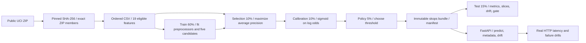

# ModelGate

**A reproducible ML training, evaluation, and HTTP serving system that knows when its model should stay a demo.**

ModelGate trains real classifiers on 41,188 ordered UCI Bank Marketing observations, freezes a model without looking at its test window, and measures what happens as the population changes. The selected model improves ranking, but fails the calibration and drift checks. The result is deliberately **HOLD**, not a claim of production readiness.

This project focuses on practical model training and evaluation: feature leakage prevention, time-based validation, train-only preprocessing, baseline comparison, probability calibration, immutable artifacts, bounded HTTP inference, batch scoring, and reproducible failure experiments. All measurements are local CPU measurements. No paid services, credentials, private application data, GPU training, or deployed customers are involved.

## Run it

Requires Python 3.12 and an internet connection for initial installation and the approximately 1 MB public dataset download. Commands run from this directory.

```sh
python3.12 -m venv .venv
.venv/bin/python -m pip install -r requirements.lock
.venv/bin/python -m pip install --no-deps .
.venv/bin/pytest -q -W error
.venv/bin/modelgate download
```

The checked-in `evidence/` contains the recorded run. Use a new output directory to reproduce it without overwriting that evidence:

```sh
.venv/bin/modelgate train --artifact artifacts/reproduce-v1 --report runs/reproduce/training.json
.venv/bin/modelgate evaluate --artifact artifacts/reproduce-v1 --output runs/reproduce/evaluation.json
.venv/bin/modelgate experiment --artifact artifacts/reproduce-v1 --output runs/reproduce/experiment.json --requests 100
.venv/bin/modelgate predict --artifact artifacts/reproduce-v1 --input examples/request.json --output runs/reproduce/predictions.json
.venv/bin/modelgate serve --artifact artifacts/reproduce-v1 --port 8765
```

In a second terminal:

```sh
curl --fail http://127.0.0.1:8765/health
curl --fail -H 'Content-Type: application/json' --data-binary @examples/request.json http://127.0.0.1:8765/v1/predict
curl --fail http://127.0.0.1:8765/v1/model
```

Interactive API documentation is at `http://127.0.0.1:8765/docs`. Stop the server with Ctrl-C. The CLI binds to loopback only. The experiment command starts and shuts down its own real servers. Output paths and artifact directories are immutable by default; choose new names for another run.

## What the recorded run actually found

The first three candidates did poorly on the next time window. Before opening the test window, two feature ablations were added that exclude calendar and economic indicators. This is **validation-informed model development**, not a preregistered benchmark or an untouched validation set. All five candidates and that decision are retained in [training.json](evidence/training.json).

| Candidate | Selection average precision | Selection ROC-AUC |
|---|---:|---:|
| Constant training prior | 0.10148 | 0.50000 |
| Logistic regression, all eligible features | 0.07196 | 0.32847 |
| Histogram gradient boosting, all eligible features | 0.09016 | 0.47117 |
| Gradient boosting, stable feature ablation | 0.10782 | 0.52710 |
| **Logistic regression, stable feature ablation** | **0.13686** | **0.58752** |

“Stable” describes the excluded time proxies; it does not promise invariance in the remaining population. The winning estimator, calibration parameters, and threshold were frozen before evaluation.

| Final test result, 6,179 rows | Measured value |
|---|---:|
| Average precision, a stepwise summary of the precision-recall curve | 0.49926 |
| Constant-score average precision / test prevalence | 0.38453 |
| ROC-AUC | 0.58981 |
| Brier score, lower is better | 0.28937 |
| Calibration-period constant prior Brier score | 0.30668 |
| Expected calibration error, 10 fixed-width bins | 0.24825 |
| Mean predicted probability / observed positive rate | 0.13628 / 0.38453 |
| Frozen decision threshold | 0.29649 |
| Precision / recall at that threshold | 0.66611 / 0.16793 |
| Assessment gate | **HOLD** |

The final window has a 38.45% positive rate, versus 4.81% in training. Ranking gains do not make the probabilities trustworthy. Calibration already slightly worsened Brier score on the independent policy window (0.07281 raw → 0.07348 calibrated); it did not fix the later population shift. There is no claim that calibration always helps.

The 95% moving-block bootstrap intervals are AP **[0.4580, 0.5387]**, ROC-AUC **[0.5754, 0.6066]**, and Brier **[0.2590, 0.3170]**. They use 200 resamples of 100-row blocks and remain approximate under nonstationarity. The ROC point estimate misses the illustrative 0.60 rule; this is a conservative engineering gate, not a significance claim. See [evaluation.json](evidence/evaluation.json) for calibration bins, age/job/contact slices, every gate condition, and drift scores.

## Design



| Ordered rows, zero-based / stop exclusive | Responsibility |
|---|---|
| `[0, 24712)` | Fit all imputation, scaling, category vocabulary, candidates, and drift reference |
| `[24712, 28831)` | Choose candidate by average precision only |
| `[28831, 32950)` | Fit regularized sigmoid calibration to frozen candidate log odds |
| `[32950, 35009)` | Choose threshold under illustrative FP cost 1 / FN cost 3 |
| `[35009, 41188)` | Assess once after model decisions are frozen |

No shuffled split is used. `duration` is unavailable before a call and is excluded by an allowlist. The outcome `y` cannot enter a pipeline. Missing numeric values are imputed using training medians; categories use an explicit `unknown` value and an encoder that tolerates unseen categories. The ablations use 12 customer/contact/history fields, removing month, weekday, and five economic indicators. The API retains the full 19-field contract for drift inspection and interchangeability.

Training reads only the development prefix. A test changes every holdout label and holdout ages and requires an identical model, report, and threshold. Chronology is inherited from UCI's row order; the CSV does not include an exact date or person identifier. Repeated-client independence cannot be proven.

## Serving and failure behavior

| Interface | Contract |
|---|---|
| `GET /health` | 200 only when the artifact loaded successfully; 503 otherwise |
| `GET /v1/model` | Model content ID, input contract, threshold, data provenance, versions |
| `POST /v1/predict` | 1–512 records; ordered probability and threshold decisions |
| `POST /v1/drift` | 100–5,000 records compared with train-derived distributions |
| `GET /v1/stats` | Process-local aggregate requests, rejections, scored rows |
| `modelgate predict` | Same validation and scoring code for a JSON batch |

Every record must include all 19 keys. Explicit `null` is supported; omitted fields, extras (including `duration`), numeric strings, booleans, infinities, invalid ranges, and category strings longer than 100 characters are rejected. Requests are limited to 2 MiB before JSON parsing, with at most 32 concurrent connections in the demo server. Request IDs and timing headers help correlate failures. Raw input values are not retained or logged by the application.

Artifacts contain a skops estimator, JSON metadata and reference distributions, and a SHA-256 manifest. Loading checks all file bytes, a fixed file set, metadata, reference distribution shape, dependency versions, the input schema, and a small reviewed type allowlist. Files are read once before deserialization; paths cannot escape through manifest entries. Bundles are published by directory rename after validation and are never silently overwritten. Hashes detect corruption; **they are not publisher authentication**. Load only local artifacts you trust. See [architecture.md](docs/architecture.md).

The gate is an offline assessment and does not deploy or disable the explicit local demo. The API reports `research_only`. There is no public authentication layer, production registry, durable request monitoring, online retraining, autoscaling, GPU inference, or distributed training.

## Measured operations

Recorded on an Apple M4 Pro with 48 GiB RAM, macOS 27.0.1 / arm64, Python 3.12.12, one server worker and model thread. Each workload uses five warmups and 100 real HTTP requests over loopback keep-alive. Runs share a developer laptop; these are observations, not service-level guarantees. These measurements were repeated after review tightened request validation.

| Workload | p50 / p95 latency | Throughput | Errors |
|---|---:|---:|---:|
| One record, sequential | 13.37 / 14.79 ms | 75.3 requests/s | 0 / 100 |
| 32 records, sequential | 14.64 / 15.36 ms | 2,225 rows/s | 0 / 100 |
| One record, four concurrent clients | 61.96 / 70.81 ms | 64.6 requests/s | 0 / 100 |

Batching amortizes Python and validation overhead. Four concurrent clients do not improve this small CPU service's throughput; no scale-out claim is warranted.

The [final failure experiment](evidence/experiment-reviewed.json) shows a malformed request returns **422**, the next valid request succeeds with **200**, and appending bytes to a copied estimator makes a restarted service return **503** for health and scoring. The [initial run](evidence/experiment.json) is retained to show measurement variability. A training-distribution replay produces zero PSI; naturally shifted holdout data and the injected age/job shift alert. PSI uses train-fixed bins, explicit missing/unseen buckets, and a documented heuristic threshold of 0.25. It detects covariate changes; it cannot establish concept drift or quantify lost accuracy without labels.

## Verification and walkthrough

`make test` runs formatting, lint, and the complete suite with warnings treated as errors. The final run passes **54 tests**, including actual fitted models and uvicorn subprocesses over TCP. [Testing notes](docs/testing.md) describe the red/green evidence and meaningful boundaries. A [separate training replay](evidence/reproducibility.json) matched all selection decisions and 500 probabilities exactly. [CI](.github/workflows/ci.yml) also downloads the public snapshot, trains, evaluates, and runs the HTTP experiment when this directory is used as a standalone repository; it has not been run on a hosted runner.

A useful walkthrough is: explain why `duration` leaks; show the test-set mutation test; compare full-feature and ablated candidates; explain why a high AP can coexist with poor calibration; corrupt an artifact; then show why local batching improved throughput while concurrent single requests did not. The hard part is defending the evaluation and failure behavior, not listing frameworks.

Data attribution, assumptions, and permissible use are in the [data card](docs/data-card.md). Intended use and limitations are in the [model card](docs/model-card.md). This is a historical Portuguese marketing dataset, not credit underwriting or an appropriate basis for real customer decisions.

## Public release verification

The November 2026 standalone packaging check installed pinned requirements and a regular wheel in a fresh Python 3.12 environment, then passed lint, formatting and all 54 tests. It did not retrain the historical public-data model or replace its recorded HOLD result. See [publication verification](evidence/publication-verification.json).

Built with AI coding tools (Claude Code and Codex CLI); I reviewed and tested the result.
